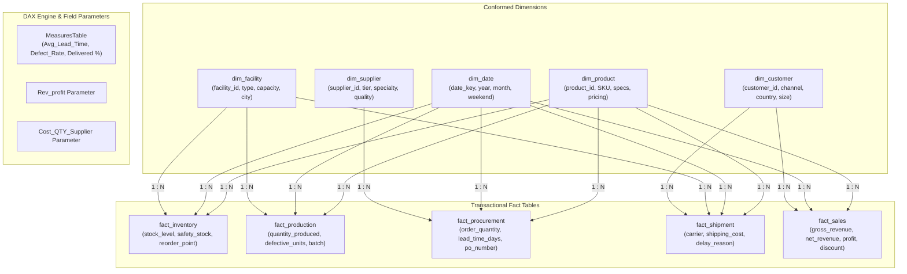
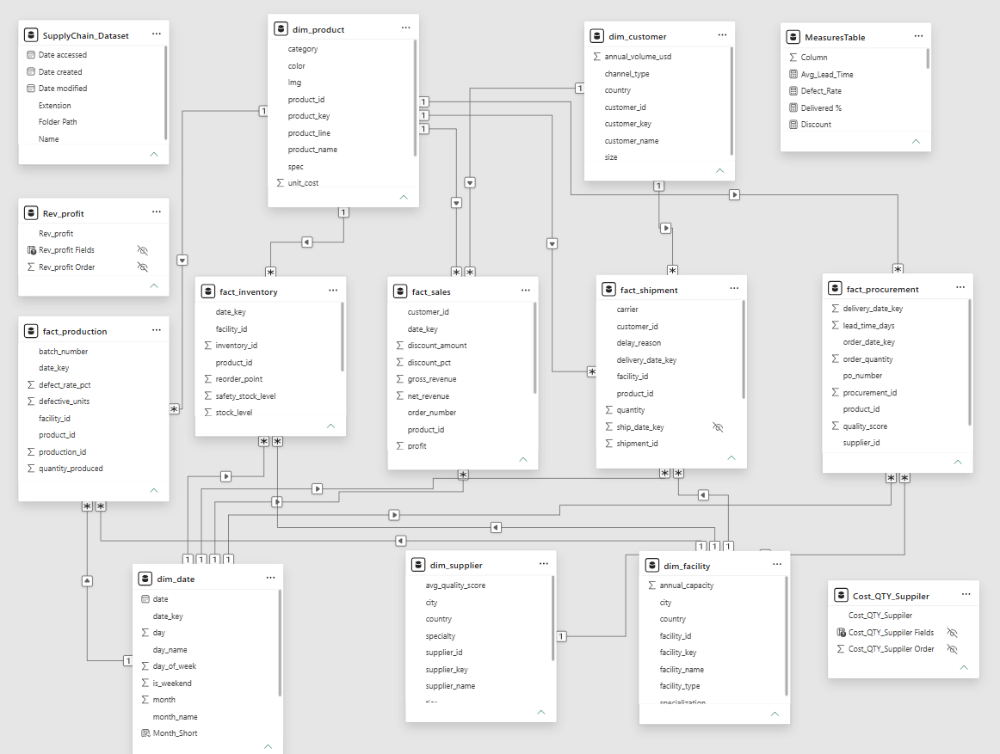

<div align="center">

# 🌐 End-to-End Supply Chain Intelligence & Analytics Platform

### *Enterprise-Grade Multi-Fact Galaxy Data Modeling & Interactive Power BI Analytics*

[](https://powerbi.microsoft.com/)
[](https://learn.microsoft.com/en-us/dax/)
[](https://learn.microsoft.com/en-us/power-query/)
[](#-data-model-architecture)
[](https://opensource.org/licenses/MIT)
[](#)

<p align="center">
  <b>A unified, cross-functional business intelligence engine designed to bridge data silos between procurement, production, warehousing, logistics, and sales fulfillment.</b>
</p>

---

</div>

## 📑 Table of Contents

- [📌 Executive Summary](#-executive-summary)
  - [The Challenge](#the-challenge)
  - [The Solution](#the-solution)
  - [Strategic Value](#strategic-value)
- [🏗️ Data Model & Architecture](#️-data-model--architecture)
  - [Entity Relationship Diagram (Galaxy Schema)](#entity-relationship-diagram-galaxy-schema)
  - [Interactive Schema Visual](#interactive-schema-visual)
- [📦 Data Dictionary](#-data-dictionary)
  - [Dimension Entities](#dimension-entities)
  - [Fact Tables](#fact-tables)
- [📐 Core DAX Measures & KPIs](#-core-dax-measures--kpis)
- [✨ Key Analytical Features](#-key-analytical-features)
- [🚀 Getting Started](#-getting-started)
  - [Prerequisites](#prerequisites)
  - [Installation & Setup](#installation--setup)
  - [Configuring Data Sources](#configuring-data-sources)
- [🗺️ Project Roadmap](#️-project-roadmap)
- [🤝 Contributing](#-contributing)
- [📄 License](#-license)
- [👤 Author & Acknowledgments](#-author--acknowledgments)

---

## 📌 Executive Summary

Modern enterprise supply chains face fractured visibility across decoupled operational silos: procurement delays cascade into manufacturing backlogs, while inaccurate safety stock estimates cause either capital-draining inventory surpluses or catastrophic customer fulfillment stockouts.

### The Challenge
- **Disconnected Data Silos**: Procurement, manufacturing, warehousing, freight carriers, and commercial sales operate on separate transactional logs without unified grain alignment.
- **Hidden Lead Time Volatility**: Unpredictable supplier delivery variance causing assembly bottlenecks.
- **Carrier Performance Blindspots**: Inability to identify recurring delivery delay root causes across transit partners.
- **Margin Erosion**: Unmonitored discounting strategies disproportionately shrinking net revenue across product lines.

### The Solution
This project consolidates raw transactional footprints into an enterprise-grade **Multi-Fact Constellation (Galaxy) Schema** within **Power BI Desktop**, standardizing temporal and dimension entities to power interactive root-cause diagnostics, dynamic scenario switching, and end-to-end supply chain visibility.

### Strategic Value
| Operational Domain | Monitored KPIs | Business Outcome |
| :--- | :--- | :--- |
| **Procurement** | `Avg_Lead_Time`, Supplier Quality Score, PO Volume | Optimizes supplier selection & negotiates lead-time SLAs |
| **Manufacturing** | `Defect_Rate`, Production Yield, Facility Capacity | Eliminates assembly line scrap & balances plant loads |
| **Inventory** | Stock Level vs. Reorder Point & Safety Stock | Mitigates stockouts while preventing overstock holding costs |
| **Logistics** | `Delivered %`, Transit Delay Reasons, Freight Spend | Holds freight carriers accountable & reduces expediting fees |
| **Commercial** | Gross vs. Net Revenue, Profit Margin %, Discounts | Protects product tier pricing and channel profitability |

---

## 🏗️ Data Model & Architecture

The analytical core is engineered around a **Multi-Fact Galaxy Schema** (also known as a Fact Constellation). Multiple transactional fact tables share conformed dimensions (`dim_date`, `dim_product`, `dim_facility`, `dim_customer`, and `dim_supplier`) with strict **1-to-many single-direction relationships** to maintain filter integrity and peak DAX engine performance.

### Entity Relationship Diagram (Galaxy Schema)



### Interactive Schema Visual

The high-performance data model implemented directly inside the Power BI tabular engine:

<div align="center">
  
  <p><i>Figure 1: Power BI Data Model View showcasing conformed dimensions, fact tables, dedicated calculation groups, and Field Parameters.</i></p>
</div>

---

## 📦 Data Dictionary

### Dimension Entities

| Entity | Primary Key | Key Attributes | Grain |
| :--- | :--- | :--- | :--- |
| **`dim_product`** | `product_id` | `product_key`, `product_name`, `category`, `product_line`, `spec`, `color`, `unit_cost`, `unit_price`, `weight_kg` | 1 record per SKU / Product |
| **`dim_customer`** | `customer_id` | `customer_key`, `customer_name`, `country`, `channel_type`, `size`, `annual_volume_usd` | 1 record per client account |
| **`dim_facility`** | `facility_id` | `facility_key`, `facility_name`, `country`, `city`, `facility_type`, `specialization`, `annual_capacity` | 1 record per manufacturing / hub facility |
| **`dim_supplier`** | `supplier_id` | `supplier_key`, `supplier_name`, `country`, `city`, `specialty`, `tier`, `avg_quality_score` | 1 record per raw material supplier |
| **`dim_date`** | `date_key` | `date`, `day`, `day_name`, `day_of_week`, `is_weekend`, `month`, `month_name`, `Month Short` | 1 record per calendar day |

### Fact Tables

| Fact Table | Foreign Keys | Key Quantitative Metrics & Attributes |
| :--- | :--- | :--- |
| **`fact_procurement`** | `product_id`, `supplier_id`, `order_date_key`, `delivery_date_key` | `order_quantity`, `unit_cost`, `total_cost`, `lead_time_days`, `quality_score`, `po_number` |
| **`fact_production`** | `product_id`, `facility_id`, `date_key` | `quantity_produced`, `defective_units`, `defect_rate_pct`, `batch_number` |
| **`fact_inventory`** | `product_id`, `facility_id`, `date_key` | `stock_level`, `safety_stock_level`, `reorder_point` |
| **`fact_shipment`** | `product_id`, `facility_id`, `customer_id`, `ship_date_key`, `delivery_date_key` | `quantity`, `carrier`, `status`, `shipping_cost`, `total_weight_kg`, `delay_reason`, `tracking_number` |
| **`fact_sales`** | `product_id`, `customer_id`, `date_key` | `quantity_sold`, `unit_price`, `discount_pct`, `discount_amount`, `gross_revenue`, `net_revenue`, `total_cost`, `profit`, `profit_margin_pct`, `order_number` |

---

## 📐 Core DAX Measures & KPIs

All business metrics are centralized within a decoupled **`MeasuresTable`** to enforce clean governance:

### 1. Delivery Performance (`Delivered %`)
```dax
Delivered % = 
DIVIDE(
    CALCULATE(COUNTROWS(fact_shipment), fact_shipment[status] = "Delivered"),
    COUNTROWS(fact_shipment),
    0
)
```

### 2. Quality Assurance (`Defect Rate`)
```dax
Defect_Rate = 
DIVIDE(
    SUM(fact_production[defective_units]),
    SUM(fact_production[quantity_produced]),
    0
)
```

### 3. Supplier Lead Time (`Avg_Lead_Time`)
```dax
Avg_Lead_Time = 
AVERAGE(fact_procurement[lead_time_days])
```

### 4. Dynamic Field Parameters
The model incorporates native Power BI **Field Parameters** (`Rev_profit` and `Cost_QTY_Suppiler`) allowing stakeholders to seamlessly toggle charts between:
- **Revenue vs. Profit analysis** without duplicating report pages.
- **Procurement Cost vs. Order Quantity per Supplier** with a single click.

---

## ✨ Key Analytical Features

- 🎯 **Executive KPI Ribbons**: High-level snapshot of fulfillment health, factory defect rates, average lead times, and aggregate profit margins.
- 🔄 **Dynamic Scenario Switching**: Leverages modern DAX Field Parameters for effortless metric-swapping across visuals.
- 📦 **Inventory Reorder Alerts**: Real-time identification of items breaching safety thresholds and approaching stockout status.
- 🚚 **Carrier SLA & Delay Decomposition**: Drill-through breakdown of shipment delays grouped by carrier partner, delay category, and freight lane.
- 🏷️ **Pricing & Discount Governance**: Evaluates commercial discounts against realized margins across Tier-1 retail partners and direct channels.

---

## 🚀 Getting Started

### Prerequisites

To view and edit the dashboard locally, make sure you have:
- [Power BI Desktop](https://powerbi.microsoft.com/desktop/) (Version 2.126+ recommended)
- [Git](https://git-scm.com/) installed on your machine
- Windows 10/11 or a compatible virtualized Windows environment

### Installation & Setup

1. **Clone the repository**:
   ```bash
   git clone https://github.com/iamharshhhh/supply-chain-analytics-powerbi.git
   cd supply-chain-analytics-powerbi
   ```

2. **Verify repository contents**:
   Ensure all `.csv` files, the `Images/` folder, and `dashboard1.pbix` are present in the directory.

3. **Open the Report**:
   - Double-click [`dashboard1.pbix`](./dashboard1.pbix) to launch Power BI Desktop.

### Configuring Data Sources

If the dataset paths need to be updated to match your local clone location:
1. In Power BI Desktop, navigate to **Home** ➔ **Transform Data** ➔ **Data source settings**.
2. Select the data sources pointing to the project folder.
3. Click **Change Source...** and select the local CSV paths in your cloned folder.
4. Click **Close & Apply** to refresh the dataset.

---

## 🗺️ Project Roadmap

- [x] Consolidate Multi-Process Fact Tables into Star/Galaxy Schema.
- [x] Engineer Centralized `MeasuresTable` with core operational DAX measures.
- [x] Implement Dynamic Field Parameters for interactive metric switching.
- [ ] Add Machine Learning-based Forecasting for inventory stockout risks.
- [ ] Implement Row-Level Security (RLS) by regional plant manager / facility ID.
- [ ] Publish to Power BI Service with automated scheduled gateway refreshes.

---

## 🤝 Contributing

Contributions, issues, and feature requests are welcome!

1. Fork the Project
2. Create your Feature Branch (`git checkout -b feature/OptimizedDAX`)
3. Commit your Changes (`git commit -m "feat: add inventory turnover ratio measure"`)
4. Push to the Branch (`git push origin feature/OptimizedDAX`)
5. Open a Pull Request

---

## 📄 License

Distributed under the **MIT License**. See `LICENSE` for more information.

---

## 👤 Author & Acknowledgments

- **Harsh Satpute** - [GitHub Profile](https://github.com/iamharshhhh) • [Email](mailto:harshsatpute207@gmail.com)
- Built with **Microsoft Power BI**, **DAX Studio**, and **Mermaid.js**.
